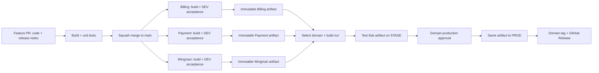

# EMP independent-release demo

This repository demonstrates a multi-team monorepo release flow using **GitHub Actions, workflow artifacts, Environments, and Releases**. The repository itself is the demo. There is no dashboard or custom release engine.

Billing, Payment Provider, and Wingman share one integration branch. Each domain can promote a tested artifact to production independently. Infrastructure deployments are simulated by running the domain's bundled code and acceptance tests in GitHub Environment jobs.

## The flow



`main` is the integration branch, equivalent to EMP's current `dev` role. It is not a declaration that every domain is ready for production. Full acceptance tests run after merge. Production state is the last successful deployment for each domain.

## Domains

| Domain | EMP owner | Example behavior | Shared build dependency |
| --- | --- | --- | --- |
| `billing` | Flamingo | Calculate a charging invoice | `@emp/money` |
| `payment` | Godzilla | Authorize and refund a payment | `@emp/money` |
| `wingman` | Hangover | Return locations from a proxy | None |

The examples use fictional code and data. They do not call EMP APIs. These three sample services have no runtime dependency on each other. This keeps the demo focused on independent promotion. Real EMP services additionally need contract tests against the relevant deployed peer versions.

## GitHub setup

Before trying a production promotion, configure the environments in **Settings → Environments**:

| Domain | DEV | STAGE | Production |
| --- | --- | --- | --- |
| Billing | `dev-billing` | `stage-billing` | `prod-billing` |
| Payment | `dev-payment` | `stage-payment` | `prod-payment` |
| Wingman | `dev-wingman` | `stage-wingman` | `prod-wingman` |

For each `prod-*` environment, add required reviewers. In a company repository, choose the owning team or its release reviewers. For this personal sandbox, choose the maintainer. Disable self-review prevention if the same person must run the entire demonstration. Restrict deployment branches to `main`.

GitHub requires approval only when environment protection is configured. An automatically created environment has no approval gate. The workflows do not configure settings for you.

Use a PR to land this setup on `main`, then use PRs for demo changes. The existing repository rules require `test` and `changeset`. PR checks retain those names; the `changeset` check now verifies that domain release descriptions exist. It does not generate versions. It can be renamed together with the repository rules later.

No secrets, registry, cloud account, or paid deployment platform is needed. `GITHUB_TOKEN` downloads artifacts and creates release records.

## Demonstrate a complete release

### 1. Establish a baseline

Merge the setup PR into `main`. Open **Actions → Build and test on DEV**. The three domain jobs build their application and run acceptance checks.

Each successful job uploads `dev-tested-<domain>-<attempt>`. Its job summary includes the build run ID, attempt, source commit, and release description. Failed domains upload no promotable artifact.

Run **Actions → Promote domain → Run workflow** from `main` with:

- Domain: `billing`.
- Build run: the numeric ID from the DEV run URL or job summary.
- Build attempt: normally `1`.

The workflow downloads the existing artifact, checks its provenance and checksums, and tests it on STAGE. Approve `prod-billing` when GitHub requests a review. The production job downloads the same immutable artifact, runs smoke checks, and creates a release such as `billing-build-123456789-1`.

Repeat for Payment and Wingman to establish their baseline releases.

### 2. Integrate work that is not ready everywhere

Open a feature PR that makes these changes:

1. In `domains/billing/src/index.mjs`, add `description: 'Charging session'` to the invoice response.
2. In `domains/wingman/src/index.mjs`, add `'Hamburg'` to the city list.
3. In `domains/payment/src/index.mjs`, deliberately change the refund result to `refundedCents: cents(amountCents)`. This accidentally converts cents a second time.
4. Describe each change in the corresponding `domains/<domain>/RELEASE.md`.

PR unit checks pass because the simplified Payment unit test covers authorization, not the full refund flow. This intentionally illustrates EMP's constraint: some defects are discovered only in acceptance testing after integration. It is not a recommendation to omit refund unit tests in production code.

Squash-merge the PR. The DEV run shows:

- Billing passes and has a promotable artifact.
- Wingman passes and has a promotable artifact.
- Payment fails: 59000 refunded cents instead of 590. It has no promotable artifact from this attempt.

The workflow uses `fail-fast: false`, so Payment's failure does not cancel the other jobs.

### 3. Release Billing and Wingman independently

Dispatch **Promote domain** once for Billing and once for Wingman, using the new build run ID. Approve each production environment.

The build run is red overall because Payment failed. Promotion deliberately accepts successful domain artifacts from that run. It validates the build's workflow, event, branch, completed attempt, and source SHA rather than requiring every domain to pass.

Payment stays on its baseline production release. Trying to promote Payment from the failed attempt stops at artifact download because that artifact does not exist.

### 4. Fix and release Payment later

Open another PR restoring `refundedCents: amountCents`, with a release-note explanation. Merge it, wait for Payment's DEV acceptance to pass, and promote Payment from that run.

No Billing or Wingman deployment is required. All three domains build on each merge in this small demo, but only the explicitly selected domain is promoted. Building everything avoids adding an affected-project tool while still including changes to shared libraries.

## Where to see what is happening

| Question | GitHub view |
| --- | --- |
| What source changes were integrated? | Merged PRs and `main` history |
| Which domain passed DEV acceptance? | Individual domain jobs and artifacts in the DEV run |
| What can be promoted? | `dev-tested-*` artifacts and their job summaries |
| What is waiting for approval? | Pending `prod-*` environment jobs |
| What was released for a domain? | Domain-specific GitHub Releases and deployment history |
| Which source and artifact were used? | Release tag, `provenance.json`, and `SHA256SUMS` |
| What changed since a domain's previous release? | Compare its previous release tag with the candidate source SHA, inspect the domain and shared dependency changes |

`RELEASE.md` is a reviewed, cumulative description of a domain. Its exact contents are bundled with each candidate and copied into the GitHub Release. PR authors should add entries with the original PR or work-item reference when available.

For a tested change intentionally deferred by a team, add a `release-held` label and a reason to its original PR, then leave its candidate unpromoted. Remove the label when it ships. This is a manual convention, not an automated gate. The minimal demo does not reconstruct a feature-level backlog automatically. Deployment state remains domain-specific, even when one PR touches several domains.

## What makes this independent

- Every domain has its own production environment and approval.
- A failed DEV job prevents only that domain's artifact from being uploaded.
- Promotion downloads the bundle and its tests from one specific run attempt. It never checks out current application source, installs dependencies, or rebuilds.
- esbuild includes shared code inside each domain bundle. A later edit to `@emp/money` cannot change an existing artifact.
- Workflow artifacts are immutable under `upload-artifact@v4`. SHA-256 checks catch accidental modification after download.
- Per-domain promotion concurrency keeps one promotion active while it moves through STAGE and approval. Other domains have separate groups.
- GitHub records a separate release tag per domain and build. The root package version does not determine deployment.

Approvals and environment deployment records identify the promotion workflow's commit. The artifact's source commit can be older. Always use the job summary or release provenance to identify the deployed source.

An older artifact may be deliberately selected, including for a rollback demonstration. GitHub's deployment history records deployment order. The demo does not enforce monotonic source revisions or model database rollback safety.

## Limits kept explicit

The jobs simulate deployment by running bundled domain code on GitHub runners. There are no continuously running DEV, STAGE, or PROD services. In EMP, replace those marked steps with the real artifact deployment adapter and environment-specific checks.

Artifact retention is 90 days. An expired or deleted artifact cannot be promoted. Release provenance survives as release assets, but application bundles are not archived there. A production implementation would use durable artifact storage.

GitHub's standard concurrency queue may replace an older pending run when several dispatches target the same domain. That cancellation is visible in Actions. Dispatch one candidate at a time per domain for the demo.

If smoke tests or release-record creation fail after a real deployment, the running version may already have changed. GitHub job success alone would not describe that partial state. This example does not implement partial infrastructure deployment or migration recovery.

Feature flags, cherry-pick selection, automated dependency resolution, package-registry publication, and per-package SemVer are intentionally outside this demo. Domain build IDs identify deployments. Changesets or Nx Release can be added separately when published library versions become part of the demonstration.

## Run the checks locally

```sh
pnpm install --frozen-lockfile
pnpm build
pnpm test
pnpm test:acceptance
```

The source and release logic are small enough to read directly:

```text
.github/workflows/pr.yml       Build and unit checks before merge
.github/workflows/dev.yml      Build and acceptance per domain after merge
.github/workflows/promote.yml  Download → STAGE → approval → PROD → Release
domains/{billing,payment,wingman}/
  src/index.mjs               Example application code
  test/unit.test.mjs          Fast PR checks
  test/acceptance.test.mjs    Tests against the built artifact
  RELEASE.md                  Reviewed release description
packages/money/               Shared library bundled into consumers
```
