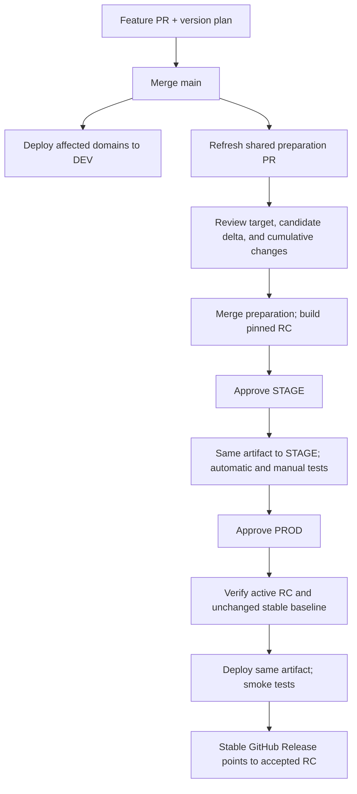

# EMP independent releases with growing RCs

The repository demonstrates independent Billing, Payment Provider, and Wingman releases. Feature PRs integrate on `main` and deploy to DEV. An automated preparation PR creates immutable release candidates for STAGE. Accepted candidates become stable production releases without rebuilding application code.

[Open the interactive guide](docs/release-guide.html) locally in your browser. The page is explanatory, uses fictional data, and makes no deployment calls.

## Your Wingman example

With production on 1.0.0:

| Event | Candidate | Notes since production |
| --- | --- | --- |
| Hamburg feature merges; preparation PR merges | `1.1.0-rc.1` | Hamburg |
| STAGE finds a problem; PROD approval rejected | rc.1 remains recorded | Nothing deployed to PROD |
| Berlin or a compatible fix merges; next preparation merges | `1.1.0-rc.2` | Hamburg + Berlin or fix |
| New candidate passes STAGE and receives PROD approval | Stable `1.1.0` references rc.2 | All included changes |

Each candidate shows **all changes since stable production** and **changes added in this candidate**. A second minor feature can join the same minor target. A major change against the stable contract escalates the target. After stable 1.1.0, a patch targets 1.1.1 and a minor feature targets 1.2.0.

Candidate numbers are monotonically increasing **per domain**, including across target changes. The next cycle might start at `1.1.1-rc.3`, rather than rc.1. This avoids reusing names after reconciliation.

## The actual flow



Preparation merges never redeploy DEV. DEV may advance while STAGE holds a frozen candidate. Integration uses `integration-<domain>` concurrency; the candidate cycle uses `release-<domain>`. A newer prepared RC supersedes older ones. Reject the older pending production deployment so its waiting workflow releases the domain lock. An old candidate cannot promote after a newer candidate record lands on main.

STAGE and PROD remain in one workflow run. Candidate artifact IDs are passed between jobs, never manually entered. Versioning is external deployment metadata in these sample applications; finalization does not rewrite the original RC provenance or bundle.

## Add a version plan in each feature PR

```sh
pnpm release:plan
```

For example:

```markdown
---
wingman: minor
---

Add Berlin to cities. PR #31.

Backward compatible. No migrations.
```

The RC adapter aggregates all unshipped changes against the last stable production version. A patch joining an active minor target keeps that target. A compatible minor joining a minor target also keeps it. New candidates need fresh STAGE validation and manual approval regardless of bump type.

Changes to shared `packages/money` must name both Billing and Payment. The demo services have no cross-service runtime dependencies; real EMP domains still need compatible contracts and mixed-version tests. RCs do not selectively remove broken features inside a domain.

## What the preparation PR contains

- Domain manifests with RC versions, updated through the Nx Release API.
- Per-domain changelog entries containing cumulative and candidate-delta sections.
- `releases/<domain>.json` with the baseline, intended target, RC sequence, immutable change IDs, and accumulated descriptions.
- Removal of consumed Nx version plans.

The shared PR prepares domain versions together, but teams approve deployments independently. It is not a global production release.

Only generated version metadata may change in a preparation PR. Source, dependency, or build-script changes must integrate separately and are rejected if mixed into a preparation. PR checks require fresh plans for source changes; removing a plan is not a way to exclude its code.

## Stable finalization and the source of truth

Stable GitHub Releases named `<domain>@v<version>` are the production baseline for versioning. Each newly finalized release attaches `release.json` with its accepted RC, source SHA, executable digest, artifact ID, and cumulative shipped change IDs.

Domain manifests remain at their last prepared **RC** after production deployment. There is no bot commit that rewrites main to a stable version and no resulting DEV deployment. The next preparation reads stable release metadata, subtracts shipped changes from the active record, and calculates the next target from remaining plans.

If an older RC finalized while preparation was running, the next preparation reconciles unshipped changes using their identities. Production preflight checks that its RC is still the current committed record, its stable baseline has not changed, and an existing stable target does not belong to another artifact. Refresh and retest a candidate when those checks fail.

Both preflight and finalization run inside the per-domain release lock, so two production candidates from these workflows cannot deploy concurrently. Preparation uses its own serialized workflow. A new preparation can still merge during production execution after preflight; the newer candidate must reconcile against the resulting stable baseline before it can promote. This demo does not implement an atomic transaction spanning Git commits, physical deployments, and GitHub Releases.

STAGE publishes a GitHub **prerelease** after its automated tests pass. The stable GitHub Release is created only after PROD smoke tests succeed. Failed STAGE tests remain in Actions even if no prerelease record was created. Rejection of a production approval does not roll STAGE back.

A failed deployment or failed final release-record step may require a retry. The original artifact remains the deployment input. If real infrastructure partly changes before a failure, deployment history needs reconciliation; this demo does not model partial CDK updates, database rollback, or transactional release-record creation.

## Existing stable-only history

Existing semantic releases are preserved. On the first RC preparation, unreleased stable-version changelog entries above the actual production baseline are imported into the active candidate scope, with their descriptions. Previously reserved version numbers are historical metadata, not automatically the new RC target.

Legacy stable releases have no `release.json`; they are accepted as migration baselines before an RC record exists. Once a cycle is active, moving to a stable baseline without shipped change IDs is rejected because safe reconciliation would otherwise be ambiguous. Do not manually create stable release tags during the RC demo.

If Wingman 1.2.0 is already in production, the next minor target is 1.3.0. We will not renumber or rewrite historical releases to reproduce an older example.

## GitHub configuration

- Keep required reviewers on all `stage-*` and `prod-*` environments. Restrict deployment branches to main. DEV is automatic.
- Enable Actions to create pull requests. The preparation workflow creates or refreshes `release/versions`, but never merges it.
- Bot-created PR checks may require manual approval or closing and reopening the PR. Optional `RELEASE_PR_TOKEN` can provide an appropriate token; a GitHub App is preferable for EMP.
- Keep required checks `test` and `changeset`, and require the preparation PR to be up to date.
- The release workflow needs `contents: write` for candidate/stable releases and `actions: write` to refresh preparation after finalization.

`Deploy DEV` and `Release domains` remain separate Actions entry points. Both select their relevant domains; the other flow ends without deployment. Path mapping is in `.github/domain-paths.yml`, including shared-library consumers.

## Tooling and verification

Nx 22.5.4 updates manifests and provides the contributor version-plan command and touched-project checks. The growing-RC policy is **custom integration** in `scripts/rc.mjs`: it uses the standard `semver` library, reads Nx plans, reconciles change records, and renders cumulative/delta notes. Nx's ordinary plan application does not implement this lifecycle automatically. `scripts/release-notes.mjs` validates PRs and presents artifact notes. GitHub remains responsible for approvals, immutable artifact storage, and release records.

```sh
pnpm install --frozen-lockfile
pnpm build
pnpm test
pnpm test:acceptance
```

`pnpm release:prepare` modifies manifests, RC records, changelogs, and plans. It needs `GH_TOKEN` and `GITHUB_REPOSITORY` to read production releases. For isolated local checks, set `RC_BASELINES` to a JSON file mapping domains to `{ "version": "1.0.0", "changeIds": [] }`. Use a disposable checkout for preparation experiments.

Tests cover Hamburg/Berlin accumulation, compatible fixes, major escalation, superseded candidates, stable-baseline reconciliation, missing identities, idempotent finalization checks, and workflow artifact routing.

Artifacts expire after 90 days and approval runs may expire earlier. GitHub concurrency retains only one pending run per group and does not guarantee FIFO. All deployments execute simulated application checks, not a long-running physical environment. No registry publication occurs.
