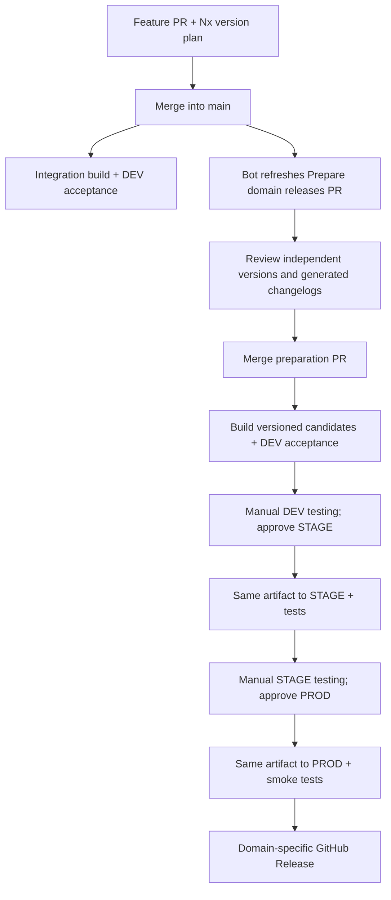

# EMP independent semantic releases

The repository is the demo. Nx Release calculates independent domain versions and changelogs. GitHub provides release-preparation PRs, artifact storage, manual environment approvals, and final release records.

| Domain | EMP owner | Example | Shared dependency |
| --- | --- | --- | --- |
| Billing | Flamingo | Charging invoices | `@emp/money` |
| Payment Provider | Godzilla | Authorization and refunds | `@emp/money` |
| Wingman | Hangover | Location proxy | None |

Code and data are fictional. Deployment jobs run bundled application code and acceptance tests on GitHub runners; they do not provision real servers or call EMP APIs. There is no dashboard.

## See what is in a release before approving

A candidate now has a version such as **Billing 1.1.0**, with generated notes listing its feature and fix descriptions. The same notes appear in:

- The **Prepare domain releases** PR body and generated `CHANGELOG.md` diff.
- The versioned DEV job summary before STAGE approval.
- The STAGE summary before PROD approval.
- The final **Billing 1.1.0** GitHub Release, tagged `billing@v1.1.0`.

Source SHA, artifact ID, and SHA-256 checksums remain available as provenance. You do not need to download an artifact to read its release notes.

## Two kinds of merge



Feature merges deploy to DEV only. Their display version is an integration identifier such as `1.0.0-dev.123456`; it is not a stable release. Plans accumulate while teams integrate and test.

Merging the preparation PR reserves stable versions, consumes their plans, and builds new candidates. Those exact versioned artifacts are tested again on DEV before manual promotion. Versioning is never applied after testing an artifact or during production deployment.

One preparation PR batches pending versions across the repository to minimize automation. Billing, Payment, and Wingman have independent version numbers and separate promotion jobs. A failed Payment acceptance test blocks only Payment's promotion, even when its version was prepared alongside Billing.

The preparation PR is not selective cherry-picking. Each artifact includes all integrated source changes in its domain and bundled dependencies at that commit. One unfinished feature can hold back its domain. The demo does not create separate release-preparation PRs per team.

## Add release intent to a feature PR

```sh
pnpm release:plan
```

Select the affected domain, select `patch`, `minor`, or `major`, and describe the change. The generated file lives in `.nx/version-plans/` and is committed with the code. For example:

```markdown
---
billing: minor
---

Add descriptions to charging invoices. See PR #22.

Backward-compatible response addition. No database migration.
```

Another Billing PR can add a patch plan for rounding. With current Billing version 1.0.0, Nx combines both plans into 1.1.0 and includes both descriptions. Payment and Wingman keep their versions unless they have plans too. A shared plan's entire description appears in each named domain's changelog; use separate plans when their explanations differ.

The compatibility promise in this demo is the domain's exported API behavior. Use patch for compatible fixes, minor for compatible additions, and major for incompatible changes. Published API clients would have their own package versions in EMP.

For a change to `packages/money`, include Billing and Payment in the plan because both bundle that code. The private library itself has no publication lifecycle here. Consumer coverage is checked explicitly; Nx's plan check covers directly touched release projects, not every source dependency.

PR checks require new plans for domain source or package-manifest changes and shared-library consumer changes. A pre-existing pending plan does not satisfy a later feature PR. Test-only or documentation-only changes need no plan. Nx generates versions and changelogs; do not maintain them by hand.

## First semantic release

Domain manifests start at `0.0.0` as a migration marker. Three initial plans create 1.0.0, with separate descriptions. Nx renders a major bump under its breaking-changes heading; the initial notes explain that this establishes the version scheme, not a new breaking change.

After this setup merges:

1. **Domain releases** validates integration builds on DEV.
2. **Prepare semantic releases** runs Nx and opens **Prepare domain releases** from `release/versions`.
3. Review its generated 1.0.0 versions and changelogs. Run or approve its required PR checks as described below.
4. Merge that preparation PR. Each changed domain builds a versioned candidate and requests STAGE approval after DEV checks.
5. Complete manual DEV testing and approve the appropriate `stage-*` environments.
6. Complete manual STAGE testing and approve `prod-*` environments.

Existing build-ID GitHub Releases remain historical records. New successful semantic releases use tags such as `billing@v1.0.0`.

## GitHub settings

Keep required reviewers on **both** `stage-billing`, `stage-payment`, `stage-wingman`, and their corresponding `prod-*` environments. DEV environments need no approval. Restrict deployment branches to `main`. For a one-person demo, leave self-review prevention disabled.

Enable **Settings → Actions → General → Allow GitHub Actions to create and approve pull requests** so the preparation workflow can open its PR. It never approves or merges that PR.

By default, the workflow uses `GITHUB_TOKEN`. Depending on GitHub's handling of bot-created PR events, their checks may need manual workflow approval or a maintainer to close and reopen the PR. If required PR checks are absent, close and reopen it as the maintainer to trigger them.

For automatic bot-PR checks, optionally set `RELEASE_PR_TOKEN` to a suitable token with repository contents and pull-request write access. A GitHub App token is preferable in EMP; that credential setup is outside this small demo. No registry or cloud credentials are needed.

The required check names `test` and `changeset` are retained for existing branch rules. The latter now validates Nx version plans. Require this branch to be up to date before merging a preparation PR, and refresh it after new feature merges. The post-merge candidate check also refuses a changed version when unconsumed plans remain for that domain.

## Reservation is different from production deployment

Nx resolves the next version from committed manifests, not production tags. A prepared 1.1.0 can remain on hold while production still runs 1.0.0. The next prepared version advances from 1.1.0 even if that candidate never reaches production. Version gaps are valid; existing versions must not be reused for different contents.

Consumed plans mean **included in a reserved version**, not **deployed to production**. Changelogs preserve the included descriptions, while GitHub Environment history and successful GitHub Releases show deployment outcomes.

Each candidate's summary shows the exact entry for its reserved version. If production skips a reserved version, the deployment includes that version's changes as well. Review all intervening entries in the committed domain changelog against the previous production release, not only the newest entry. The complete changelog is also attached to the final GitHub Release.

The release PR updates while plans accumulate. New source changes require fresh candidate testing. Preparation is serialized, and production refuses an existing semantic release with a different source SHA. Rerunning a failed deployment uses the original artifact output rather than rebuilding during promotion.

## Path selection and manual-test stability

`.github/domain-paths.yml` selects integration workflows:

| Changed paths | Domains |
| --- | --- |
| `domains/billing/**` | Billing |
| `domains/payment/**` | Payment |
| `domains/wingman/**` | Wingman |
| `packages/money/**` | Billing and Payment |
| Root dependencies, Nx/build/release configuration | All |
| Root documentation only | None |

Only a change to a domain's committed version enables STAGE and PROD jobs. An ordinary source change starts DEV only. Preparation PRs update manifests and changelogs, so path selection includes their domains automatically. New version plans alone refresh the preparation PR without starting domain deployments.

Each domain's release workflow keeps its concurrency slot from DEV through manual approvals. New runs for that domain wait while an older candidate is being tested. Unrelated domains continue. GitHub retains only one pending run per group; further merges may replace queued runs. This is a small-demo queue, not a durable candidate backlog. If a versioned run is cancelled before deployment, its version stays reserved in Git and its notes stay in the changelog; rerun the original workflow when appropriate or prepare a later version.

## Tooling and local checks

The demo pins **Nx 22.5.4**, matching the inspected EMP setup, and **pnpm 10.34.7**. Nx 22.5.4 cannot parse pnpm 12's multi-document lockfile. esbuild still creates standalone domain bundles. Nx handles version calculation, plan consumption, and changelog generation.

The small `scripts/release-notes.mjs` adapter presents generated entries, recognizes version changes, and checks fresh-plan coverage. It does not compute SemVer, maintain deployment state, or choose feature commits. `peter-evans/create-pull-request` handles release-PR updates.

```sh
pnpm install --frozen-lockfile
pnpm build
pnpm test
pnpm test:acceptance
pnpm exec nx release --dry-run --skip-publish
```

`pnpm release:prepare` changes manifests and consumes plans. Run it only on a release-preparation branch or let CI do it. It does not publish npm packages or create production tags.

Artifacts expire after 90 days and approval runs can expire sooner. Jobs simulate deployment, not partial CDK changes or database recovery. The demo has no cross-service runtime dependencies; EMP still needs backward-compatible APIs, events, migrations, and contract tests for independently deployed peers.
