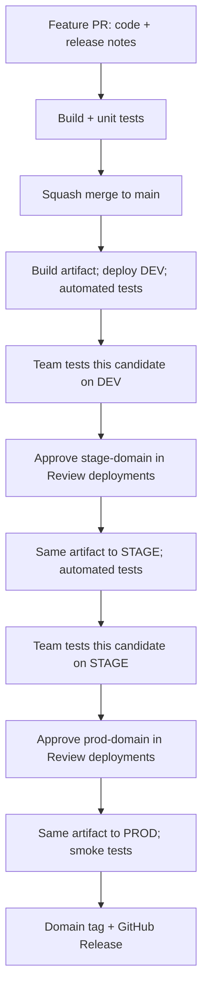

# EMP independent-release demo

This repository demonstrates independent domain releases using GitHub Actions, immutable artifacts, Environments, and Releases. There is no dashboard or custom release engine.

Billing, Payment Provider, and Wingman share `main` as their integration branch. Each domain builds once and promotes the same artifact through DEV, STAGE, and PROD. Deployments are simulated by executing bundled application code and acceptance tests in GitHub Environment jobs.

## The flow for each domain



The three domains follow this sequence independently in the same workflow run. There is no build ID to copy and no promotion workflow to dispatch. A failed or waiting Payment job does not block Billing or Wingman.

Automated tests are prerequisites, not release approval. The team approves STAGE only after manual DEV testing, then approves PROD after manual STAGE testing. Add a test-evidence link or explanation in the GitHub approval comment.

## Domains

| Domain | EMP owner | Example behavior | Shared build dependency |
| --- | --- | --- | --- |
| `billing` | Flamingo | Calculate a charging invoice | `@emp/money` |
| `payment` | Godzilla | Authorize and refund a payment | `@emp/money` |
| `wingman` | Hangover | Return locations from a proxy | None |

These are fictional implementations with no calls to EMP APIs. The sample domains have no runtime dependencies on each other. Real EMP domains also need contract tests against the relevant deployed peer versions.

## Configure approvals before merging the workflows

In **Settings → Environments**, create or update:

| Domain | DEV, no approval | STAGE, required reviewer | PROD, required reviewer |
| --- | --- | --- | --- |
| Billing | `dev-billing` | `stage-billing` | `prod-billing` |
| Payment | `dev-payment` | `stage-payment` | `prod-payment` |
| Wingman | `dev-wingman` | `stage-wingman` | `prod-wingman` |

For every `stage-*` and `prod-*` environment:

1. Enable **Required reviewers** and select the maintainer for this personal demo, or the owning team's reviewers in a company repository.
2. Leave **Prevent self-review** disabled if one person runs the demonstration.
3. Restrict deployment branches to `main`.

GitHub pauses a job only when required reviewers are configured. Merely naming an environment in YAML does not create an approval gate. An automatically created environment has no reviewer protection. Configure both stages before merging this workflow change.

The existing required PR checks `test` and `changeset` are retained. The latter verifies that domain release descriptions exist; it does not generate versions. No custom secrets or cloud accounts are needed.

## Demonstrate independent releases

### 1. Establish the baseline

Merge the setup PR into `main`, then open **Actions → Domain releases**.

Each domain's DEV job builds its bundle, runs acceptance tests, and uploads an immutable artifact. The summary shows the source SHA, release description, and artifact link. Its STAGE job then waits for approval.

Use **Review deployments** to approve `stage-billing` after reviewing the candidate and completing manual DEV testing. Billing deploys to STAGE and runs its automated checks. It then waits at `prod-billing`. Complete manual STAGE testing and approve production.

Repeat for Payment and Wingman. You can approve several environment entries together when their candidates are ready, or advance one domain at a time.

Each production job creates a domain release such as `billing-build-123456789-1`, including the source commit, workflow link, provenance, and checksums. The run ID is traceability metadata, not user input.

### 2. Merge changes with different readiness

Open a feature PR with these changes:

1. Add `description: 'Charging session'` to the invoice response in `domains/billing/src/index.mjs`.
2. Add `'Hamburg'` to the cities in `domains/wingman/src/index.mjs`.
3. In `domains/payment/src/index.mjs`, deliberately return `refundedCents: cents(amountCents)`. This incorrectly converts cents a second time.
4. Describe the changes in the corresponding `domains/<domain>/RELEASE.md` files.

PR unit tests pass because the small Payment unit test covers authorization. Its full refund acceptance test runs after merge. This deliberately demonstrates late defect discovery, not a recommended gap in production unit coverage.

After merging, Billing and Wingman pass DEV checks and wait for their STAGE approvals. Payment fails acceptance with 59000 refunded cents instead of 590. It uploads no promotable artifact and never reaches STAGE approval.

Test and approve Billing and Wingman through both environments. Payment retains its baseline production release. No branch manipulation or feature flags are needed.

### 3. Demonstrate a manual hold

For an automatically passing candidate that still needs manual work, leave its STAGE approval pending. Record the reason on its PR or workflow discussion. It remains visible in Actions as waiting for review. Other domains can continue.

To abandon a candidate, reject its environment deployment. Avoid cancelling the whole workflow run unless all domains should stop. GitHub review approvals do not themselves prove manual testing happened; the reviewer is responsible for the evidence.

### 4. Fix and release Payment

Open a PR restoring `refundedCents: amountCents` and explain the fix in `domains/payment/RELEASE.md`. Merge, wait for Payment's DEV tests, and approve its STAGE and PROD jobs after manual testing.

The minimal demo builds every domain on each merge, including shared code. It therefore also creates new Billing and Wingman candidates. Their production jobs still require separate approval; they do not have to release with Payment.

## Keep the candidate stable during manual testing

The reusable workflow has one concurrency group per domain with cancellation disabled. A domain reserves its slot from DEV through both approvals and PROD. A newer merge cannot overwrite that domain's DEV or STAGE candidate while the team tests it. Other domains use separate groups.

The tradeoff is deliberate: while Billing waits for approval, newer Billing runs wait before deployment to DEV. This small demo prioritizes a stable manual-test candidate over a continuously advancing shared DEV environment.

GitHub's standard concurrency queue retains at most one running and one pending workflow per group. Further merges can replace older pending candidates, with cancellations visible in Actions. The newest candidate contains the integrated source changes. This is not an unlimited release backlog.

When evolving the demo to real EMP environments, revisit this policy if DEV must always advance. Separate test environments or explicit version checks would then be needed to prevent stale manual approval.

## Trace the release through GitHub

| Question | View |
| --- | --- |
| What was integrated? | Merged PRs and `main` history |
| Which domains passed automated DEV tests? | Domain DEV jobs and uploaded artifacts |
| What needs manual testing and STAGE approval? | Pending `stage-*` jobs and DEV summaries |
| What needs production approval? | Pending `prod-*` jobs and STAGE summaries |
| What shipped for a domain? | Domain-specific GitHub Releases and deployment history |
| What exact code and artifact were tested? | Source SHA, artifact ID, `provenance.json`, and `SHA256SUMS` |

`RELEASE.md` is a reviewed, cumulative description of a domain. Its contents travel with the artifact and appear in its GitHub Release. Add original PR or work-item references when available. Compare the previous domain release tag with the candidate source to investigate unreleased source changes, including shared dependencies.

## Artifact guarantees and demo limits

esbuild bundles shared code into each application. STAGE and PROD download the same artifact by its immutable Actions artifact ID. They perform no source checkout, dependency installation, or rebuild. Checksums and provenance are verified in both jobs.

Job outputs carry the artifact ID between steps, including when only failed jobs are rerun. Artifact names include the build attempt to avoid collisions when DEV is rebuilt. The release tag uses the attempt stored inside that artifact, not the attempt of a later production retry.

The environment jobs simulate deployment on GitHub runners. There are no long-running DEV, STAGE, or PROD services. Manual approval demonstrates the team decision, rather than interaction with a deployed user interface. Real EMP deployment adapters and acceptance checks would replace the marked simulation steps.

Artifacts expire after 90 days. GitHub can also expire long-waiting approval runs. An expired or deleted artifact cannot be promoted. Release provenance survives as release assets, but application bundles are not archived there. A real implementation needs durable artifact storage and a candidate-expiry policy.

If a real deployment changes infrastructure before a test or release-record step fails, production may already have changed. This example does not model partial infrastructure deployment, migrations, or data recovery.

The demo uses domain build IDs, not package SemVer. Published libraries and their Changesets or Nx release process can be added separately. It does not implement feature selection inside an artifact: without feature flags, unfinished behavior holds back that domain's candidate.

## Local checks and workflow files

```sh
pnpm install --frozen-lockfile
pnpm build
pnpm test
pnpm test:acceptance
```

```text
.github/workflows/pr.yml              Build and unit checks before merge
.github/workflows/release.yml         Three independent calls on a main push
.github/workflows/domain-release.yml  DEV → STAGE approval → STAGE → PROD approval → PROD
domains/{billing,payment,wingman}/
  src/index.mjs                      Example application code
  test/unit.test.mjs                 Fast PR checks
  test/acceptance.test.mjs           Tests against the built artifact
  RELEASE.md                        Reviewed release description
packages/money/                      Shared library bundled into consumers
```
